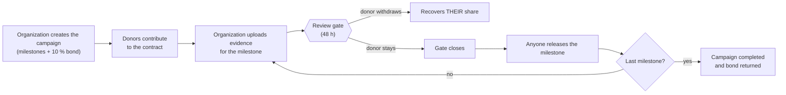
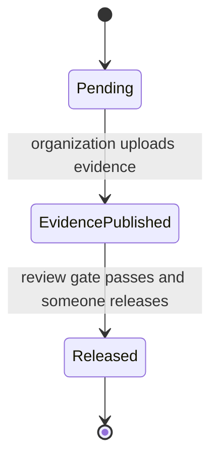
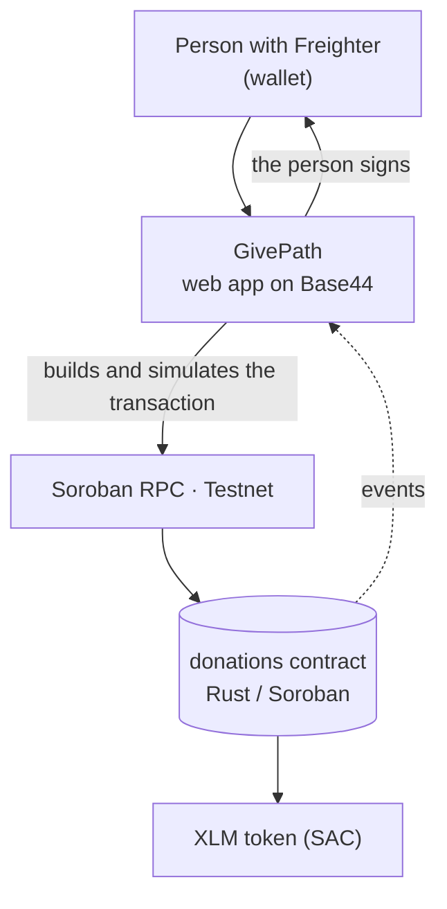
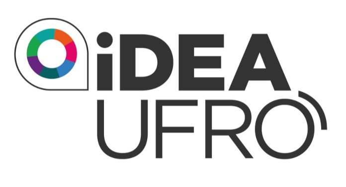

<div align="center">

# GivePath

**The path of giving.**

🌐 [🇨🇱 Español](README.md) · 🇬🇧 English

Donations released in stages that every donor can audit, on the Stellar network.



<br/>


</div>

---

## Table of contents

- [What is GivePath](#what-is-givepath)
- [Key features](#key-features)
- [How it works](#how-it-works)
- [The design decision](#the-design-decision)
- [An example with numbers](#an-example-with-numbers)
- [Creator bond](#creator-bond)
- [Tech stack](#tech-stack)
- [Architecture](#architecture)
- [Contract rules](#contract-rules)
- [Installation and setup](#installation-and-setup)
- [Usage: trying the web app with Freighter on Testnet](#usage-trying-the-web-app-with-freighter-on-testnet)
- [Tested on Testnet](#tested-on-testnet)
- [Repository structure](#repository-structure)
- [What's next](#whats-next)
- [License](#license)
- [Authors and acknowledgements](#authors-and-acknowledgements)

---

## What is GivePath

When you donate to a campaign, your money goes into someone else's hands and what you can see ends there. You trust that it was used well, and that trust almost always rests on an organization that says it has no profit motive.

GivePath changes the order: **the money doesn't go to the organization, it goes to a Stellar smart contract (Soroban).** There it stays split into milestones and only leaves when a milestone is met. Before each release, a **48-hour review gate** opens where the donor can look at the evidence and decide: stay in, or withdraw their share.

There are no administrators and no verifiers. **Control belongs to the donor, and only over their own money.**

The name comes from the idea of a path: the campaign advances milestone by milestone, and each milestone is a gate that funds only cross once it opens.

### The problem it solves

| Problem in traditional donations | How GivePath addresses it |
|---|---|
| The donor loses visibility as soon as the money is handed over | Funds sit in a public contract and every movement is a verifiable transaction |
| The organization receives everything upfront | It receives only the amount of each milestone, when that milestone is released |
| You have to trust a third party to verify progress | No third parties: each donor judges the evidence for their own share |
| If the organization walks away, the money is lost | Donors withdraw what remains and split the creator's bond |

---

## Key features

- **Funds held by the contract.** No person or organization can move the money outside the rules of the code.
- **Release by milestones.** Each milestone has its own amount and is paid only after its review gate.
- **Individual exit.** During the review gate, each donor can withdraw their share. No one can freeze anyone else's funds.
- **No verifiers, no votes.** The M-of-N signature model was discarded because it is vulnerable to Sybil attacks (see [The design decision](#the-design-decision)).
- **Creator bond (10 % of the goal).** Filters out junk campaigns and partially compensates donors if the organization disappears.
- **Open release.** When the gate closes, anyone can execute the release.
- **Evidence anchored on-chain.** Photos are stored off-chain and their SHA-256 fingerprint is recorded in the contract.
- **Per-campaign audit.** The app compares its totals against the contract's getters.
- **No custody in the app.** The user signs the transaction in Freighter; GivePath never sees a secret key.

---

## How it works

1. **The organization creates the campaign.** It defines its milestones with an amount each and locks a **bond of 10 % of the goal** in the contract.
2. **Donors contribute.** The money stays in the contract. You can't donate more than what is missing to reach the goal.
3. **The organization uploads evidence** for the first milestone: photos and a description. The blockchain stores the fingerprint (hash) of that evidence.
4. **The review gate opens** (48 hours in the app). While it is open, **each donor can withdraw their share**. Only their own.
5. **When the gate closes, anyone can release the milestone.** It is paid with what the donors who stayed left in.
6. **The process repeats milestone by milestone.** When the last one is completed, the bond returns to the organization.
7. **If the organization abandons the campaign**, once the deadline passes donors withdraw what remains and **the bond is split among them**.

### Milestone states



During `EvidencePublished` donors can leave. Their leaving doesn't change the milestone's state: it only reduces the money available to release.

---

## The design decision

The first version used **verifiers**: wallets that approved each milestone with an M-of-N signature threshold. It was discarded because whoever creates the campaign can control several wallets and present them as independent verifiers (a Sybil attack), approving themselves. Accrediting verifiers brings back the intermediary that the blockchain was meant to remove, and opening disputes to anyone lets them freeze everyone's funds for no reason.

**What remained is individual exit:** nobody approves or freezes anything, and a malicious wallet can only withdraw its own money. If the creator sets up ten friendly wallets, those wallets only decide about what they themselves deposited.

> No blockchain can verify that something happened in the real world. Someone has to judge the evidence. In GivePath, that someone is each donor, and only over their own money.

---

## An example with numbers

A campaign with one **50 XLM** milestone. Ana donates 60 and Beto donates 40, so the contract holds 100.

| Moment | Held | Ana | Beto |
|---|---:|---:|---:|
| Both donate | 100 | 60 | 40 |
| The organization uploads evidence and the gate opens | 100 | 60 | 40 |
| Beto isn't convinced and withdraws (recovers 40) | 60 | 60 | 0 |
| The gate closes and the milestone is released (50 to the organization) | 10 | 10 | 0 |

Beto left with everything that was his. Ana stayed and her money funded the milestone. Nobody had to ask permission for anything.

### Share-based accounting

The contract keeps its books like a pooled fund, using shares:

| Concept | Rule |
|---|---|
| Variables | `S` = total shares, `H` = money held |
| When donating `x` | First donor: receives `x` shares. Later donors: `x × S / H` |
| Value of your position | `your shares × H / S` |
| When a milestone is released | `H` goes down and `S` stays the same, so everyone loses in the same proportion |
| If `H` reaches 0 | `S` goes back to 0 and the campaign's **epoch** increases; old positions are worth zero and can't contaminate new donations |
| Arithmetic | Fully checked; integer division truncates downward, so the contract never pays out more than it holds |

---

## Creator bond

Publishing a campaign has a cost: the organization locks **10 % of the goal** from day one.

| If... | The bond... |
|---|---|
| All milestones are completed | Returns to the organization |
| The campaign is cancelled before receiving donations | Returns to the organization |
| The organization abandons it (deadline passes without completion) | Goes to the donors who still have funds in the contract, proportionally |
| The deadline passes and no donor is left | The organization recovers it |

---

## Tech stack

| Layer | Technology |
|---|---|
| Smart contract | Rust + Soroban (Stellar), tests with `cargo test` |
| Network | Stellar Testnet, Soroban RPC |
| Asset | Native XLM through its Stellar Asset Contract (SAC) |
| Wallet | Freighter |
| SDK | TypeScript bindings generated from the WASM |
| Web app | Base44 |
| Reference backend | Node.js 20+, Fastify, SQLite-based indexer |
| Tooling | pnpm, Stellar CLI, PowerShell and Bash scripts |
| Explorers | stellar.expert, Stellar Lab |

---

## Architecture



- **The contract is the source of truth.** Funds, states, deadlines and rules live there. No screen can bypass it.
- **The app holds nothing in custody.** It builds the unsigned transaction, the user signs it in their wallet, and it is sent to the network.
- **Photos are stored in GivePath; their hash is stored on the blockchain.** The SHA-256 fingerprint proves the image hasn't changed, and uploading full images on-chain isn't viable.
- **Each campaign's audit** compares the totals shown by the app against the contract's getters.
- **No admin in the contract.** Nobody can move money outside the rules.

The repository also includes a **reference backend** (a REST API with Fastify and an SQLite-based indexer). It is an alternative implementation that reads the same contract; the Base44 app does not depend on it.

### Interface

| Section | What it does |
|---|---|
| **Home** | Introduces the project and featured campaigns |
| **Campaigns** | Browse, and open each one to donate, view milestones, donation log and **Audit** |
| **How it works** | Explains the flow for first-time visitors |
| **My dashboard** | For campaign creators: upload evidence for the next milestone and see the status of each campaign |
| **Donations** | The campaigns I donated to, with their current value; from there I can open each one or withdraw my share |

Every record on screen links to its transaction on [stellar.expert](https://stellar.expert/explorer/testnet).

---

## Contract rules

| Function | Called by | When |
|---|---|---|
| `create_campaign` | Organization | Always; locks the bond |
| `donate` | Donor (never the organization of that campaign) | Active campaign, before the deadline and without exceeding the goal |
| `submit_evidence` | Organization | Milestones in order and with enough funds |
| `withdraw` | Donor | While the gate is open, or after the deadline if the campaign wasn't completed |
| `release_milestone` | **Anyone** | Gate closed and funds held |
| `reclaim_bond` | Organization | Deadline passed and no donors with funds |
| `cancel_campaign` | Organization | Only before receiving donations |

**Parameters:** review gate from 60 s to 30 days (48 h by default in the app and 60 s in demo mode), maximum deadline of 1 year, bond configured only once at initialization. There is no administrator, no verifiers, no votes and no disputes. Error codes and events are in [`docs/CONTRACT_API.md`](docs/CONTRACT_API.md).

The contract tests cover: happy path, donating over the goal, the organization donating to its own campaign, out-of-order milestones, withdrawing inside and outside the gate, early release, abandonment with bond distribution, epoch reset, cancellation and rounding.

---

## Installation and setup

**Requirements:** Rust 1.84+ with the `wasm32v1-none` target, Stellar CLI, Node.js 20+ and pnpm.

### 1. Clone and install dependencies

```powershell
git clone <REPOSITORY-URL> givepath
cd givepath
pnpm install --frozen-lockfile
```

### 2. Test and build the contract

```powershell
cargo test -p donations
stellar contract build --package donations
pnpm build
```

### 3. Configure the Testnet network

If the CLI complains about `network passphrase is missing`, define the network explicitly:

```powershell
$env:STELLAR_RPC_URL = "https://soroban-testnet.stellar.org"
$env:STELLAR_NETWORK_PASSPHRASE = "Test SDF Network ; September 2015"
```

### 4. Deploy

You need an account funded by Friendbot. The secret goes in `.env` (which is in `.gitignore`) and never in the repository. The scripts `scripts/deploy.ps1` and `scripts/deploy.sh` automate deployment; the manual steps are in [`docs/DEPLOY.md`](docs/DEPLOY.md).

### 5. Test the full flow

It takes a few minutes because it waits for the gates:

```powershell
pnpm smoke-test
pnpm --filter @clearfun/scripts exec tsx seed.ts
```

> **Note about the clock:** the scripts measure time with the network's clock, not your computer's. If your clock runs ahead, the script thinks the gate has already closed and the contract answers `WindowNotOpen` (error 16). That is why the smoke test waits a fixed amount of time.

---

## Usage: trying the web app with Freighter on Testnet

To use the GivePath app you need a Freighter wallet connected to Testnet and test funds. Testnet XLM has no real value.

### 1. Install Freighter

Install the [Freighter](https://www.freighter.app/) extension in your browser (Chrome, Brave, Edge or Firefox) and create a new wallet. Keep your recovery phrase somewhere safe and don't share it with anyone.

### 2. Switch the network to Testnet

In Freighter, open the network selector and choose **Testnet**. Check that the network name appears at the top of the extension before continuing.

### 3. Load test credits with Friendbot

Friendbot is Stellar's service that hands out test XLM. There are two ways:

- **From Freighter:** with the network set to Testnet, use your account's **Fund with Friendbot** button, if it appears.
- **From Stellar Lab:** go to [Stellar Lab](https://lab.stellar.org/account/fund?$=network$id=testnet&label=Testnet&horizonUrl=https:////horizon-testnet.stellar.org&rpcUrl=https:////soroban-testnet.stellar.org&passphrase=Test%20SDF%20Network%20/;%20September%202015;;), paste your public address (it starts with `G`) and press **Fund account with Friendbot**.

You will receive 10,000 test XLM. If you need more, repeat the step with another address.

### 4. Connect the wallet to GivePath

Open the GivePath app, press **Connect wallet** and approve the connection in Freighter. Every action that moves funds (donate, withdraw, release, upload evidence) opens a Freighter window so you can sign the transaction.

### 5. Try both roles

To see the full flow it helps to use **two Freighter accounts**, both funded by Friendbot:

| Role | Steps |
|---|---|
| **Organization** | In **My dashboard**, create a campaign with its milestones and the 10 % bond. Once there are donations, upload the evidence for the first milestone. |
| **Donor** | In **Campaigns**, open the campaign and donate. When the review gate opens, decide: withdraw your share or leave it. Check your funds in **Donations**. |
| **Anyone** | When the gate closes, release the milestone from the campaign page. |

> The organization can't donate to its own campaign, so you need a second account for the donor role.

Every transaction is recorded and linked to [stellar.expert](https://stellar.expert/explorer/testnet), where you can check what happened.

---

## Tested on Testnet

Final deployed contract: [`CDF2FZ4N7ECQUK4Y2B2HVL6FT7A6OBRYZAOEA4MU45KYJBRMWE24SFA5`](https://lab.stellar.org/r/testnet/contract/CDF2FZ4N7ECQUK4Y2B2HVL6FT7A6OBRYZAOEA4MU45KYJBRMWE24SFA5)

A complete campaign, end to end, with real transactions (campaign 9):

| Step | Transaction |
|---|---|
| Create campaign with 2 milestones and bond | [3b311e7a…](https://stellar.expert/explorer/testnet/tx/3b311e7a7e017a0c4a6bc84395ac99bf0c12ae7d70c90708c0216fb4a7460582) |
| Donor 1 contributes | [91814832…](https://stellar.expert/explorer/testnet/tx/91814832ca786ac7d74310f2406dc86fba88a7c297806c4011d993e974c67be1) |
| Donor 2 contributes | [2aafbdee…](https://stellar.expert/explorer/testnet/tx/2aafbdee21a253edd2f27228ff5d58ca50a6b9cd753433b6a2c9bc62a3aa3fe0) |
| Evidence for milestone 1 | [4bda354d…](https://stellar.expert/explorer/testnet/tx/4bda354d38c0abc4cc91782df0e99fa1eaacfb693b4bea64c1fb0e61ce6672f0) |
| **Donor 1 withdraws inside the review gate** | [0c91bf68…](https://stellar.expert/explorer/testnet/tx/0c91bf68f46885722ddbd1e5d77466ae12aad23ec8dd95fc0d6001c6c14488f7) |
| **Release of milestone 1** (called by an arbitrary account) | [4cda1744…](https://stellar.expert/explorer/testnet/tx/4cda1744b2314669a308964eb1f15c177ca51c99b191d8ab5d0fb02308af6848) |
| Evidence for milestone 2 | [c9a237dc…](https://stellar.expert/explorer/testnet/tx/c9a237dcf81e4600b92f5eb3e7c68f00d37c91e83758dc2d2a20b10b789587cc) |
| **Final release and bond returned** | [3708dc94…](https://stellar.expert/explorer/testnet/tx/3708dc94500ca00fb8d324c3248bb671beea89e320616d31c59befce16ba34e4) |

At the end, the script checks that the organization received exactly what was released, that the bond came back, and that the contract balance adds up. A second complete campaign (campaign 10) generated by the seed is in [`docs/SEED_RESULT.md`](docs/SEED_RESULT.md).

---

## Repository structure

```text
contracts/donations/   Soroban contract in Rust and its tests
packages/sdk/          TypeScript bindings generated from the WASM
backend/               Fastify API + indexer (reference implementation)
scripts/               Deploy, smoke-test and seed
docs/                  Contract API, security, architecture and notes
```

| Document | Contents |
|---|---|
| [`CONTRACT_API.md`](docs/CONTRACT_API.md) | Functions, errors and events |
| [`ARCHITECTURE.md`](docs/ARCHITECTURE.md) | Funds, shares and trust boundaries |
| [`SECURITY_CHECKLIST.md`](docs/SECURITY_CHECKLIST.md) | Controls and pending items before production |
| [`BASE44_CHANGES.md`](docs/BASE44_CHANGES.md) | Rules for each button and interface changes |
| [`PITCH_SCRIPT.md`](docs/PITCH_SCRIPT.md) | Presentation script |

**Previous contract (legacy):** `CAFXICHEYMOI42VUO3AH7UJ5DYHJ6GGPHDYVH2RS6ITR42JCM5MQI5FI` is the first version, with verifiers. It is kept as history and is not part of the final solution.

---

## What's next

- External audit of the contract before moving real funds.
- A stablecoin (USDC) with a verified issuer.
- Tests with real users to see whether 48 hours is the right window.
- A notification to the donor when a review gate opens, so that silence isn't caused by oversight.

---

## License

Distributed under the **MIT** license. See the [`LICENSE`](LICENSE) file for details.

---

## Authors and acknowledgements

| | |
|---|---|
| **Sofía Candia** | Civil Engineering in Telematics, Universidad de La Frontera |
| **Consuelo Licanqueo** | Civil Engineering in Industrial Engineering, Universidad de La Frontera |

We thank **Stellar**, in partnership with **iDEAUFRO**, and the **Agrupación Bandurr[IA] UFRO**.

<div align="center">

&nbsp;&nbsp;&nbsp;
&nbsp;&nbsp;&nbsp;


<br/>


Made in Chile for the University Track of the **Stellar · Find Your Way** hackathon.

*GivePath: the path of giving.*

</div>
