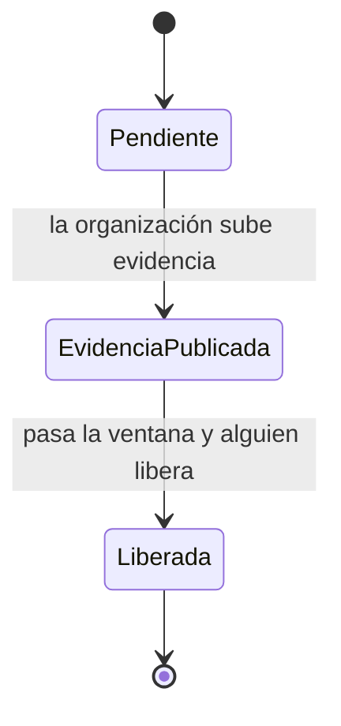
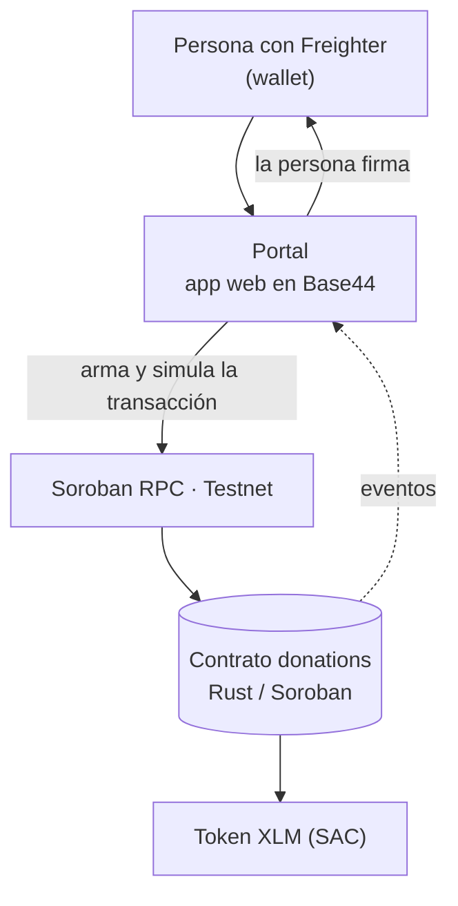

<div align="center">

# ClearFund

**Donaciones que se pueden auditar, sobre la red Stellar.**

</div>

---

## La idea en un minuto

Cuando donas a una campaña, tu dinero pasa a manos de alguien y ahí se acaba lo que puedes ver. Confías en que la usaron bien, y casi siempre esa confianza descansa en una organización que dice no tener fines de lucro.

ClearFund cambia el orden de las cosas: **el dinero no va a la organización, va a un contrato.** Ahí se queda, dividido en etapas, y solo sale cuando una etapa se cumple. Y quien decide si el dinero sigue o se devuelve no es un tercero: **es cada donante, con su propia parte.** Cada etapa es una puerta cerrada, y los fondos solo pasan cuando se abre.

---

## Cómo funciona


1. **Crea la campaña.** Define sus etapas con un monto cada una y deja una **garantía del 10 % de la meta** bloqueada en el contrato.
2. **Los donantes aportan.** El dinero queda en el contrato. No se puede donar más de lo que falta para la meta.
3. **La organización sube evidencia** de la primera etapa, fotos y descripción. En la blockchain queda la huella (hash) como evidencia.
4. **Se abre una ventana pública** Durante 48 horas, mientras está abierta, **cada donante puede retirar su parte**, solo la suya.
5. **Cuando la ventana cierra, se libera la etapa.** Se paga con lo que dejaron los donantes que se quedaron.
6. **Se repite etapa por etapa.** Al completar la última, la garantía vuelve a la organización.
7. **Si la organización abandona**, pasado el plazo los donantes retiran lo que queda y **la garantía se reparte entre ellos**.

### Estados de una etapa



Durante `EvidenciaPublicada` los donantes pueden salir. Que salgan no cambia el estado de la etapa: solo reduce el dinero disponible para liberar. Que los donantes no retiren su aporte, depende de que tan trasparentes sean las evidencias subidas con anterioridad.

---

## Ejemplo

Campaña con una etapa de **50 XLM**. Ana dona 60 y Beto dona 40, así que el contrato retiene 100.

| Momento | Retenido | Ana | Beto |
|---|---:|---:|---:|
| Ambos donan | 100 | 60 | 40 |
| La organización sube evidencia, se abre la ventana | 100 | 60 | 40 |
| Beto no está convencido y se retira (recupera 40) | 60 | 60 | 0 |
| Cierra la ventana y se libera la etapa (50 a la organización) | 10 | 10 | 0 |

Beto salió con todo lo suyo. Ana siguió y su dinero financió la etapa. A nadie se le pidió permiso para nada.

### Cómo se cuenta por dentro

El contrato lleva la contabilidad por **participaciones**, como un fondo común:

- Al donar `x`, recibes `x` participaciones si eres el primero, y `x × S / H` si no (`S` = participaciones totales, `H` = dinero retenido).
- Tu valor en cualquier momento es `tus participaciones × H / S`.
- Cuando se libera una etapa baja `H` y las participaciones no cambian, así que **todos pierden en la misma proporción**.
- Si `H` llega a cero, `S` vuelve a cero y la "época" de la campaña sube. Las posiciones antiguas valen cero y no pueden contaminar donaciones nuevas.
- Toda la aritmética es checked y la división entera trunca hacia abajo, así que el contrato nunca paga más de lo que tiene.

---

## Garantía del creador

Publicar una campaña tiene costo. La organización deja **10 % de la meta** bloqueado desde el primer día.

| Si... | La garantía... |
|---|---|
| Completa todas las etapas | Vuelve a la organización |
| Cancela antes de recibir donaciones | Vuelve a la organización |
| Abandona (vence el plazo sin completar) | Pasa a los donantes que aún tienen fondos en el contrato, en proporción |
| Vence el plazo y no queda ningún donante | La organización la recupera |

Sirve de filtro contra campañas basura y de compensación parcial si alguien desaparece.

---

## Arquitectura



- **El contrato es la fuente de verdad.** Fondos, estados, plazos y reglas viven ahí. Ninguna pantalla puede saltárselo.
- **El sistema no custodia nada.** Arma la transacción sin firmar, la firma el usuario en su wallet y se envía a la red.
- **Las fotos se guardan en Portal; su hash queda en la blockchain.** La huella SHA-256 prueba que la imagen no cambió. 
- **La auditoría de cada campaña** compara los totales que muestra con los getters del contrato, para esa campaña.

El repositorio incluye además un **backend de referencia** (API REST con Fastify y un indexer sobre SQLite). Es una implementación alternativa que lee el mismo contrato; la app en Base44 no depende de él.

### Interfaz

| Sección | Qué hace |
|---|---|
| **Inicio** | Presenta el proyecto y las campañas destacadas |
| **Campañas** | Explorar, y entrar a cada una para donar, ver etapas, registro de donaciones y **Auditar** |
| **Cómo funciona** | Explicación del flujo para quien llega por primera vez |
| **Mi panel** | Para quien crea campañas: subir evidencia de la siguiente etapa, ver estado de cada una |
| **Donaciones** | Las campañas a las que doné, con su valor actual. Desde ahí puedo entrar a cada una o retirar mi parte |

Cada registro en pantalla enlaza a su transacción en [stellar.expert](https://stellar.expert/explorer/testnet).

---

## Probado en Testnet

Contrato final desplegado: [`CDF2FZ4N7ECQUK4Y2B2HVL6FT7A6OBRYZAOEA4MU45KYJBRMWE24SFA5`](https://lab.stellar.org/r/testnet/contract/CDF2FZ4N7ECQUK4Y2B2HVL6FT7A6OBRYZAOEA4MU45KYJBRMWE24SFA5)

Una campaña completa, de punta a punta, con transacciones reales (campaña 9):

| Paso | Transacción |
|---|---|
| Crear campaña con 2 etapas y garantía | [3b311e7a…](https://stellar.expert/explorer/testnet/tx/3b311e7a7e017a0c4a6bc84395ac99bf0c12ae7d70c90708c0216fb4a7460582) |
| Donante 1 aporta | [91814832…](https://stellar.expert/explorer/testnet/tx/91814832ca786ac7d74310f2406dc86fba88a7c297806c4011d993e974c67be1) |
| Donante 2 aporta | [2aafbdee…](https://stellar.expert/explorer/testnet/tx/2aafbdee21a253edd2f27228ff5d58ca50a6b9cd753433b6a2c9bc62a3aa3fe0) |
| Evidencia de la etapa 1 | [4bda354d…](https://stellar.expert/explorer/testnet/tx/4bda354d38c0abc4cc91782df0e99fa1eaacfb693b4bea64c1fb0e61ce6672f0) |
| **Donante 1 se retira dentro de la ventana** | [0c91bf68…](https://stellar.expert/explorer/testnet/tx/0c91bf68f46885722ddbd1e5d77466ae12aad23ec8dd95fc0d6001c6c14488f7) |
| **Liberación de la etapa 1** (llamada por una cuenta cualquiera) | [4cda1744…](https://stellar.expert/explorer/testnet/tx/4cda1744b2314669a308964eb1f15c177ca51c99b191d8ab5d0fb02308af6848) |
| Evidencia de la etapa 2 | [c9a237dc…](https://stellar.expert/explorer/testnet/tx/c9a237dcf81e4600b92f5eb3e7c68f00d37c91e83758dc2d2a20b10b789587cc) |
| **Liberación final y garantía devuelta** | [3708dc94…](https://stellar.expert/explorer/testnet/tx/3708dc94500ca00fb8d324c3248bb671beea89e320616d31c59befce16ba34e4) |

El script comprueba al final que la organización recibió exactamente lo liberado, que la garantía volvió y que el saldo del contrato cuadra. Hay una segunda campaña completa (la 10) generada por el seed, en [`docs/SEED_RESULT.md`](docs/SEED_RESULT.md).

Los tests del contrato cubren: flujo feliz, donación sobre la meta, la organización donando a su propia campaña, etapas fuera de orden, retiro dentro y fuera de ventana, liberación antes de tiempo, abandono con reparto de garantía, reinicio de época, cancelación y redondeo.

---

## Límites que no vamos a esconder

- **El silencio equivale a aceptar.** Quien no revisa su donación durante la ventana deja que se libere.
- **Evidencia falsa.** El contrato no puede verificar el mundo real; solo le da a cada donante tiempo y poder para decidir.
- **Es un prototipo en Testnet.** El contrato no está auditado y no debe usarse con fondos de valor real. El XLM nativo se usa mediante su Stellar Asset Contract; no hay USDC oficial configurado.
- Todo en la cadena es público e irreversible.

---

## Reglas del contrato en una tabla

| Función | Quién la llama | Cuándo |
|---|---|---|
| `create_campaign` | Organización | Siempre; deja la garantía |
| `donate` | Donante (nunca la organización de esa campaña) | Campaña activa, antes del plazo y sin pasar la meta |
| `submit_evidence` | Organización | Etapas en orden y con fondos suficientes |
| `withdraw` | Donante | Con ventana abierta, o vencido el plazo sin campaña completada |
| `release_milestone` | **Cualquiera** | Ventana vencida y fondos retenidos |
| `reclaim_bond` | Organización | Plazo vencido y sin donantes con fondos |
| `cancel_campaign` | Organización | Solo antes de recibir donaciones |

Parámetros: ventana de 60 s a 30 días (48 h por defecto en la app y 60 s en modo demo), plazo máximo de 1 año, garantía configurada una sola vez al inicializar. No existe administrador, ni verificadores, ni votos, ni disputas. Códigos de error y eventos en [`docs/CONTRACT_API.md`](docs/CONTRACT_API.md).

---

## Correrlo tú mismo

Requisitos: Rust 1.84+ con el target `wasm32v1-none`, Stellar CLI, Node.js 20+ y pnpm.

```powershell
pnpm install --frozen-lockfile
cargo test -p donations
stellar contract build --package donations
pnpm build
```

**Red de Testnet.** Si el CLI se queja de `network passphrase is missing`, define la red de forma explícita:

```powershell
$env:STELLAR_RPC_URL = "https://soroban-testnet.stellar.org"
$env:STELLAR_NETWORK_PASSPHRASE = "Test SDF Network ; September 2015"
```

**Desplegar.** Hace falta una cuenta con fondos de Friendbot. El secreto va en `.env` (que está en `.gitignore`) y jamás en el repo ni en el chat. Los scripts `scripts/deploy.ps1` y `scripts/deploy.sh` automatizan el despliegue; los pasos a mano están en [`docs/DEPLOY.md`](docs/DEPLOY.md).

**Probar el flujo completo** en Testnet (tarda unos minutos porque espera las ventanas):

```powershell
pnpm smoke-test
pnpm --filter @clearfun/scripts exec tsx seed.ts
```

Nota: Los scripts miden el tiempo con el reloj de la red. Si tu reloj va adelantado, el script cree que la ventana ya cerró y el contrato responde `WindowNotOpen` (error 16). Por eso el smoke-test espera un tiempo fijo.

---

## Estructura del repositorio

```text
contracts/donations/   Contrato Soroban en Rust y sus tests
packages/sdk/          Bindings TypeScript generados desde el WASM
backend/               API Fastify + indexer (implementación de referencia)
scripts/               Deploy, smoke-test y seed
docs/                  API del contrato, seguridad, arquitectura y notas
```

| Documento | Contenido |
|---|---|
| [`CONTRACT_API.md`](docs/CONTRACT_API.md) | Funciones, errores y eventos |
| [`ARCHITECTURE.md`](docs/ARCHITECTURE.md) | Fondos, participaciones y límites de confianza |
| [`SECURITY_CHECKLIST.md`](docs/SECURITY_CHECKLIST.md) | Controles y pendientes antes de producción |
| [`BASE44_CHANGES.md`](docs/BASE44_CHANGES.md) | Reglas de cada botón y cambios de interfaz |
| [`PITCH_SCRIPT.md`](docs/PITCH_SCRIPT.md) | Guion de la presentación |

**Contrato anterior (legacy):** `CAFXICHEYMOI42VUO3AH7UJ5DYHJ6GGPHDYVH2RS6ITR42JCM5MQI5FI` es la primera versión, con verificadores. Se conserva como historial y no forma parte de la solución final.

---

## Qué sigue

- Auditoría externa del contrato antes de mover fondos reales.
- Un activo estable (USDC) con emisor verificado.
- Pruebas con usuarios reales para validar si 48 horas es un plazo adecuado.
- Aviso al donante cuando se abra una ventana, para que el silencio no sea por descuido.

---

<div align="center">

Hecho en Chile para la hackathon **Stellar · Find Your Way**.

</div>
