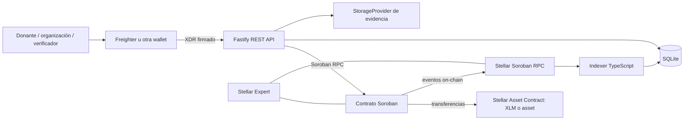

# ClearFun

**Donaciones transparentes, liberadas cuando la comunidad verifica resultados.**

ClearFun es una plataforma de donaciones construida sobre Stellar. El dinero
queda en escrow on-chain y se libera a una organización por hitos cuando se
publica evidencia y un umbral de verificadores la aprueba. Los eventos son
públicos y el backend los indexa para ofrecer consultas y auditoría.

> **English summary:** ClearFun is a transparent donation platform on Stellar.
> Contributions are held in Soroban escrow and released to organizations only
> after milestone evidence is approved by a verifier threshold. An event
> indexer and REST API make campaign progress and fund flows easy to audit.

## Problema y solución

Los donantes suelen tener poca visibilidad sobre el destino de sus aportes; las
transferencias internacionales y pasarelas tradicionales también encarecen
las microdonaciones. ClearFun registra aportes y decisiones en Stellar:

- El donante puede consultar recaudación, hitos, aprobaciones y transacciones.
- La organización no recibe los fondos antes de demostrar el hito acordado.
- Un umbral M-de-N de verificadores autoriza la liberación desde el contrato.
- Si una campaña vence sin completarse, el contrato habilita reembolsos
  proporcionales sobre los fondos todavía no liberados.

ClearFun es un prototipo de hackathon en Testnet, no una entidad financiera ni
un sistema auditado para custodiar fondos reales.

## Arquitectura



### Cómo se usan Stellar y Soroban

- El contrato Rust/Soroban mantiene campañas, donaciones, evidencia, votos y
  estados de liberación en la red Stellar Testnet.
- XLM nativo y activos emitidos se usan mediante sus Stellar Asset Contracts
  (SAC), a través de la interfaz de token de Soroban.
- La billetera del usuario firma las autorizaciones. El backend prepara XDR,
  nunca recibe semillas de usuario y envía solo envelopes firmados.
- El contrato publica eventos indexables y el backend los proyecta a SQLite.
- La red Stellar ofrece liquidación rápida y comisiones bajas; latencia y fee
  dependen del estado de la red. XLM y USDC de prueba no son equivalentes a
  dinero real.

## Red Testnet y demo

- Contrato ClearFun: [ver en Stellar Expert](https://stellar.expert/explorer/testnet/contract/CAFXICHEYMOI42VUO3AH7UJ5DYHJ6GGPHDYVH2RS6ITR42JCM5MQI5FI)
- SAC XLM nativo: [ver en Stellar Expert](https://stellar.expert/explorer/testnet/contract/CDLZFC3SYJYDZT7K67VZ75HPJVIEUVNIXF47ZG2FB2RMQQVU2HHGCYSC)
- Deploy y transacciones de verificación: [`docs/PHASE_2_DONE.md`](docs/PHASE_2_DONE.md)
- API interactiva: `/docs`; documento OpenAPI: [`docs/openapi.json`](docs/openapi.json)

El despliegue Testnet existente es una instancia compartida para pruebas. No
introduzcas datos personales ni evidencia sensible. El script de seed crea
campañas nuevas en cada ejecución y registra transacciones públicas e
irreversibles en Testnet.

## Requisitos

- Rust y target `wasm32v1-none`, Stellar CLI.
- Node.js 20 o superior, pnpm.
- Docker Desktop o Docker Engine + Docker Compose (solo para contenedores).

## Inicio rápido

Desde la raíz del monorepo:

```powershell
Copy-Item .env.example .env
pnpm install --frozen-lockfile
pnpm build
pnpm test
pnpm lint
pnpm format:check
```

Edita `.env` con el `CONTRACT_ID`, los endpoints y las identidades de Testnet
necesarias. No guardes claves en archivos versionados ni uses secretos de
producción. Para iniciar API e indexer en local:

```powershell
pnpm --filter @clearfun/backend dev
```

Luego consulta `http://localhost:3000/health` y `http://localhost:3000/docs`.
Los pasos completos de instalación, contratos y tokens están en
[`docs/DEPLOY.md`](docs/DEPLOY.md); el despliegue de backend con Compose/Render
está en [`docs/DEPLOY_BACKEND.md`](docs/DEPLOY_BACKEND.md).

### Cargar datos de demo en Testnet

Configura en `.env` `CONTRACT_ID`, `TOKEN_XLM_ID`,
`SMOKE_ORG_SECRET`, `SMOKE_DONOR_SECRET`, `SMOKE_DONOR_2_SECRET`,
`SMOKE_DONOR_3_SECRET`, `SMOKE_VERIFIER_1_SECRET` y `SMOKE_VERIFIER_2_SECRET`.
Las cuentas deben tener XLM de Testnet para fees y donaciones. Después ejecuta:

```powershell
pnpm --filter @clearfun/scripts seed
```

El seed crea tres campañas y comprueba on-chain una campaña completada, otra
al 50 % recaudado con una aprobación pendiente y una tercera parcialmente
financiada. Cada ejecución añade campañas nuevas.

## Estructura del repositorio

```text
contracts/donations/  Contrato Rust/Soroban y pruebas
backend/              API Fastify, indexer y SQLite
packages/sdk/         Bindings TypeScript generados desde el contrato
scripts/              Deploy, configuración de SAC, smoke test y seed
docs/                 Arquitectura, API, despliegue, pitch y handoff
```

## Documentación

- [`docs/ARCHITECTURE.md`](docs/ARCHITECTURE.md): roles, flujo de fondos,
  controles y limitaciones.
- [`docs/CONTRACT_API.md`](docs/CONTRACT_API.md): métodos, eventos y errores
  del contrato.
- [`docs/FRONTEND_HANDOFF.md`](docs/FRONTEND_HANDOFF.md): pantallas, endpoints
  y firma con Freighter.
- [`docs/SECURITY_CHECKLIST.md`](docs/SECURITY_CHECKLIST.md): checklist y
  pendientes de seguridad conocidos.
- [`docs/PITCH_SCRIPT.md`](docs/PITCH_SCRIPT.md): guion breve para el video.

## Roadmap

- [x] Contrato Soroban con escrow por hitos y verificadores.
- [x] Despliegue y smoke test en Stellar Testnet.
- [x] Indexer de eventos Soroban y API REST.
- [x] Preparación de transacciones wallet-signed y almacenamiento de evidencia.
- [x] Contenerización y blueprint de despliegue del backend.
- [x] Datos demo y materiales de transferencia a frontend/pitch.
- [ ] Resolver los pendientes del checklist de seguridad antes de un uso con
      fondos de valor.
- [ ] Construir el frontend en una herramienta separada (fuera del alcance de
      este repositorio).
- [ ] Evaluación externa del contrato y despliegue de producción solo después
      de pruebas, revisión legal y auditoría.
