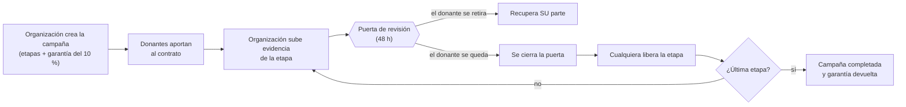
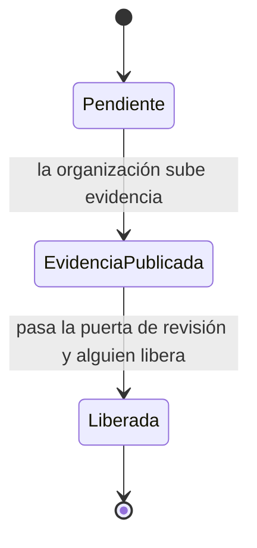
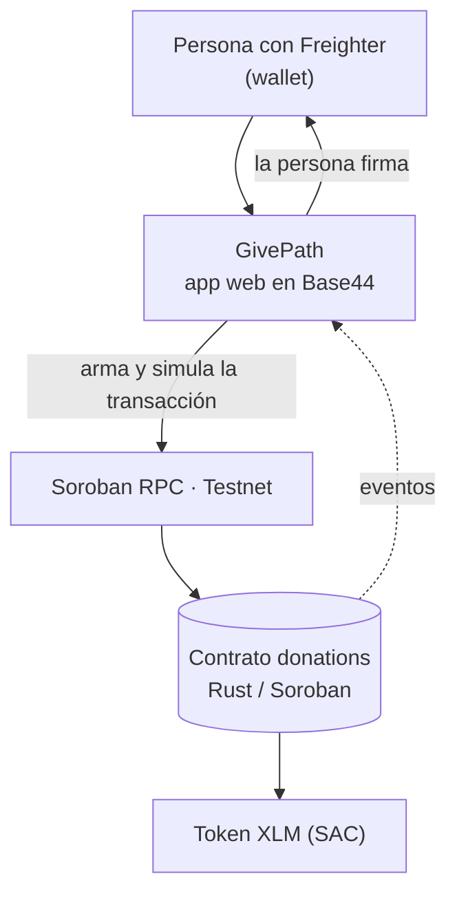

<div align="center">

# GivePath

**El camino de la donación.**

Donaciones que se liberan por etapas y que cada donante puede auditar, sobre la red Stellar.



<br/>


</div>

---

## Tabla de contenidos

- [Qué es GivePath](#qué-es-givepath)
- [Características principales](#características-principales)
- [Cómo funciona](#cómo-funciona)
- [La decisión de diseño](#la-decisión-de-diseño)
- [Un ejemplo con números](#un-ejemplo-con-números)
- [Garantía del creador](#garantía-del-creador)
- [Tecnologías utilizadas](#tecnologías-utilizadas)
- [Arquitectura](#arquitectura)
- [Reglas del contrato](#reglas-del-contrato)
- [Instalación y configuración](#instalación-y-configuración)
- [Uso: probar la web con Freighter en Testnet](#uso-probar-la-web-con-freighter-en-testnet)
- [Probado en Testnet](#probado-en-testnet)
- [Estructura del repositorio](#estructura-del-repositorio)
- [Qué sigue](#qué-sigue)
- [Licencia](#licencia)
- [Autoras y agradecimientos](#autoras-y-agradecimientos)

---

## Qué es GivePath

Cuando donas a una campaña, tu dinero pasa a manos de alguien y ahí termina lo que puedes ver. Confías en que lo usaron bien, y esa confianza descansa casi siempre en una organización que dice no tener fines de lucro.

GivePath cambia el orden: **el dinero no va a la organización, va a un contrato inteligente de Stellar (Soroban).** Ahí queda dividido en etapas y solo sale cuando una etapa se cumple. Antes de cada liberación se abre una **puerta de revisión de 48 horas** donde el donante puede mirar la evidencia y decidir: seguir o retirar su parte.

No hay administradores ni verificadores. **El control es de quien dona, y solo sobre su propia plata.**

El nombre viene de la idea de camino: la campaña avanza etapa a etapa y cada etapa es una puerta que los fondos solo cruzan cuando se abre.

### El problema que resuelve

| Problema en las donaciones tradicionales | Cómo lo aborda GivePath |
|---|---|
| El donante pierde visibilidad apenas entrega el dinero | Los fondos quedan en un contrato público y cada movimiento es una transacción verificable |
| La organización recibe todo por adelantado | Recibe solo el monto de cada etapa, cuando la etapa se libera |
| Hay que confiar en un tercero que verifique el avance | No hay terceros: cada donante juzga la evidencia de su propia parte |
| Si la organización abandona, el dinero se pierde | Los donantes retiran lo que queda y se reparten la garantía del creador |

---

## Características principales

- **Fondos en custodia del contrato.** Ninguna persona ni organización puede mover el dinero fuera de las reglas del código.
- **Liberación por etapas.** Cada etapa tiene su monto y se paga solo después de su puerta de revisión.
- **Salida individual.** Durante la puerta de revisión, cada donante puede retirar su parte. Nadie puede congelar los fondos de los demás.
- **Sin verificadores ni votos.** Se descartó el modelo de firmas M de N por su vulnerabilidad a ataques Sybil (ver [La decisión de diseño](#la-decisión-de-diseño)).
- **Garantía del creador (10 % de la meta).** Filtra campañas basura y compensa parcialmente a los donantes si la organización desaparece.
- **Liberación abierta.** Cuando la puerta se cierra, cualquier persona puede ejecutar la liberación.
- **Evidencia anclada a la cadena.** Las fotos se guardan fuera de la cadena y su huella SHA-256 queda registrada en el contrato.
- **Auditoría por campaña.** La app compara sus totales con los getters del contrato.
- **Sin custodia en la app.** La transacción la firma el usuario en Freighter; GivePath nunca ve una clave secreta.

---

## Cómo funciona

1. **La organización crea la campaña.** Define sus etapas con un monto cada una y deja una **garantía del 10 % de la meta** bloqueada en el contrato.
2. **Los donantes aportan.** El dinero queda en el contrato. No se puede donar más de lo que falta para la meta.
3. **La organización sube evidencia** de la primera etapa: fotos y descripción. En la blockchain queda la huella (hash) de esa evidencia.
4. **Se abre la puerta de revisión** (48 horas en la app). Mientras está abierta, **cada donante puede retirar su parte**. Solo la suya.
5. **Cuando la puerta se cierra, cualquier persona puede liberar la etapa.** Se paga con lo que dejaron los donantes que se quedaron.
6. **Se repite etapa por etapa.** Al completar la última, la garantía vuelve a la organización.
7. **Si la organización abandona**, pasado el plazo los donantes retiran lo que queda y **la garantía se reparte entre ellos**.

### Estados de una etapa



Durante `EvidenciaPublicada` los donantes pueden salir. Que salgan no cambia el estado de la etapa: solo reduce el dinero disponible para liberar.

---

## La decisión de diseño

La primera versión usaba **verificadores**: wallets que aprobaban cada etapa con un umbral de M firmas de N. Se descartó porque quien crea la campaña puede controlar varias wallets y presentarlas como verificadores independientes (ataque Sybil), con lo que se aprueba a sí mismo. Acreditar verificadores reinstala al intermediario que la blockchain debía eliminar, y abrir disputas a cualquiera permite congelar los fondos de todos sin motivo.

**Lo que quedó es la salida individual:** nadie aprueba ni congela nada, y una wallet maliciosa solo puede retirar su propio dinero. Si el creador pone diez wallets amigas, esas wallets solo deciden sobre lo que ellas mismas depositaron.

> Ninguna blockchain puede comprobar que algo ocurrió en el mundo real. Alguien tiene que juzgar la evidencia. En GivePath, ese alguien es cada donante, y solo sobre su propia plata.

---

## Un ejemplo con números

Campaña con una etapa de **50 XLM**. Ana dona 60 y Beto dona 40, así que el contrato retiene 100.

| Momento | Retenido | Ana | Beto |
|---|---:|---:|---:|
| Ambos donan | 100 | 60 | 40 |
| La organización sube evidencia y se abre la puerta | 100 | 60 | 40 |
| Beto no está convencido y se retira (recupera 40) | 60 | 60 | 0 |
| Se cierra la puerta y se libera la etapa (50 a la organización) | 10 | 10 | 0 |

Beto salió con todo lo suyo. Ana siguió y su dinero financió la etapa. A nadie se le pidió permiso para nada.

### Contabilidad por participaciones

El contrato lleva la cuenta como un fondo común, con participaciones:

| Concepto | Regla |
|---|---|
| Variables | `S` = participaciones totales, `H` = dinero retenido |
| Al donar `x` | Primer donante: recibe `x` participaciones. Siguientes: `x × S / H` |
| Valor de tu posición | `tus participaciones × H / S` |
| Al liberar una etapa | `H` baja y `S` no cambia, así que todos pierden en la misma proporción |
| Si `H` llega a 0 | `S` vuelve a 0 y la **época** de la campaña sube; las posiciones antiguas valen cero y no contaminan donaciones nuevas |
| Aritmética | Toda checked; la división entera trunca hacia abajo, así que el contrato nunca paga más de lo que tiene |

---

## Garantía del creador

Publicar una campaña tiene costo: la organización deja **10 % de la meta** bloqueado desde el primer día.

| Si... | La garantía... |
|---|---|
| Completa todas las etapas | Vuelve a la organización |
| Cancela antes de recibir donaciones | Vuelve a la organización |
| Abandona (vence el plazo sin completar) | Pasa a los donantes que aún tienen fondos en el contrato, en proporción |
| Vence el plazo y no queda ningún donante | La organización la recupera |

---

## Tecnologías utilizadas

| Capa | Tecnología |
|---|---|
| Contrato inteligente | Rust + Soroban (Stellar), tests con `cargo test` |
| Red | Stellar Testnet, Soroban RPC |
| Activo | XLM nativo mediante su Stellar Asset Contract (SAC) |
| Wallet | Freighter |
| SDK | Bindings TypeScript generados desde el WASM |
| App web | Base44 |
| Backend de referencia | Node.js 20+, Fastify, indexer sobre SQLite |
| Herramientas | pnpm, Stellar CLI, scripts en PowerShell y Bash |
| Explorador | stellar.expert, Stellar Lab |

---

## Arquitectura



- **El contrato es la fuente de verdad.** Fondos, estados, plazos y reglas viven ahí. Ninguna pantalla puede saltárselo.
- **La app no custodia nada.** Arma la transacción sin firmar, la firma el usuario en su wallet y se envía a la red.
- **Las fotos se guardan en GivePath; su hash queda en la blockchain.** La huella SHA-256 prueba que la imagen no cambió, y subir las imágenes completas a la cadena no es viable.
- **La auditoría de cada campaña** compara los totales que muestra la app con los getters del contrato.
- **Sin administrador en el contrato.** Nadie puede mover dinero fuera de las reglas.

El repositorio incluye además un **backend de referencia** (API REST con Fastify y un indexer sobre SQLite). Es una implementación alternativa que lee el mismo contrato; la app en Base44 no depende de él.

### Interfaz

| Sección | Qué hace |
|---|---|
| **Inicio** | Presenta el proyecto y las campañas destacadas |
| **Campañas** | Explorar, y entrar a cada una para donar, ver etapas, registro de donaciones y **Auditar** |
| **Cómo funciona** | Explicación del flujo para quien llega por primera vez |
| **Mi panel** | Para quien crea campañas: subir evidencia de la siguiente etapa y ver el estado de cada una |
| **Donaciones** | Las campañas a las que doné, con su valor actual; desde ahí puedo entrar a cada una o retirar mi parte |

Cada registro en pantalla enlaza a su transacción en [stellar.expert](https://stellar.expert/explorer/testnet).

---

## Reglas del contrato

| Función | Quién la llama | Cuándo |
|---|---|---|
| `create_campaign` | Organización | Siempre; deja la garantía |
| `donate` | Donante (nunca la organización de esa campaña) | Campaña activa, antes del plazo y sin pasar la meta |
| `submit_evidence` | Organización | Etapas en orden y con fondos suficientes |
| `withdraw` | Donante | Con la puerta abierta, o vencido el plazo sin campaña completada |
| `release_milestone` | **Cualquiera** | Puerta cerrada y fondos retenidos |
| `reclaim_bond` | Organización | Plazo vencido y sin donantes con fondos |
| `cancel_campaign` | Organización | Solo antes de recibir donaciones |

**Parámetros:** puerta de revisión de 60 s a 30 días (48 h por defecto en la app y 60 s en modo demo), plazo máximo de 1 año, garantía configurada una sola vez al inicializar. No existe administrador, ni verificadores, ni votos, ni disputas. Códigos de error y eventos en [`docs/CONTRACT_API.md`](docs/CONTRACT_API.md).

Los tests del contrato cubren: flujo feliz, donación sobre la meta, la organización donando a su propia campaña, etapas fuera de orden, retiro dentro y fuera de la puerta, liberación antes de tiempo, abandono con reparto de garantía, reinicio de época, cancelación y redondeo.

---

## Instalación y configuración

**Requisitos:** Rust 1.84+ con el target `wasm32v1-none`, Stellar CLI, Node.js 20+ y pnpm.

### 1. Clonar e instalar dependencias

```powershell
git clone <URL-DEL-REPOSITORIO> givepath
cd givepath
pnpm install --frozen-lockfile
```

### 2. Probar y compilar el contrato

```powershell
cargo test -p donations
stellar contract build --package donations
pnpm build
```

### 3. Configurar la red de Testnet

Si el CLI se queja de `network passphrase is missing`, define la red de forma explícita:

```powershell
$env:STELLAR_RPC_URL = "https://soroban-testnet.stellar.org"
$env:STELLAR_NETWORK_PASSPHRASE = "Test SDF Network ; September 2015"
```

### 4. Desplegar

Hace falta una cuenta con fondos de Friendbot. El secreto va en `.env` (que está en `.gitignore`) y jamás en el repositorio. Los scripts `scripts/deploy.ps1` y `scripts/deploy.sh` automatizan el despliegue; los pasos a mano están en [`docs/DEPLOY.md`](docs/DEPLOY.md).

### 5. Probar el flujo completo

Tarda unos minutos porque espera las ventanas:

```powershell
pnpm smoke-test
pnpm --filter @clearfun/scripts exec tsx seed.ts
```

> **Nota sobre el reloj:** los scripts miden el tiempo con el reloj de la red, no el de tu computador. Si tu reloj va adelantado, el script cree que la puerta ya cerró y el contrato responde `WindowNotOpen` (error 16). Por eso el smoke-test espera un tiempo fijo.

---

## Uso: probar la web con Freighter en Testnet

Para usar la app de GivePath necesitas una wallet Freighter conectada a Testnet y fondos de prueba. Los XLM de Testnet no tienen valor real.

### 1. Instalar Freighter

Instala la extensión [Freighter](https://www.freighter.app/) en tu navegador (Chrome, Brave, Edge o Firefox) y crea una wallet nueva. Guarda tu frase de recuperación en un lugar seguro y no la compartas con nadie.

### 2. Cambiar la red a Testnet

En Freighter, abre el selector de red y elige **Testnet**. Verifica que el nombre de la red aparezca en la parte superior de la extensión antes de continuar.

### 3. Cargar créditos de prueba con Friendbot

Friendbot es el servicio de Stellar que entrega XLM de prueba. Tienes dos formas:

- **Desde Freighter:** con la red en Testnet, usa el botón **Fund with Friendbot** de tu cuenta, si aparece.
- **Desde Stellar Lab:** entra a [Stellar Lab](https://lab.stellar.org/account/fund?$=network$id=testnet&label=Testnet&horizonUrl=https:////horizon-testnet.stellar.org&rpcUrl=https:////soroban-testnet.stellar.org&passphrase=Test%20SDF%20Network%20/;%20September%202015;;), pega tu dirección pública (empieza con `G`) y presiona **Fund account with Friendbot**.

Recibirás 10.000 XLM de prueba. Si la cuenta ya existe y necesitas más, repite el paso con otra dirección.

### 4. Conectar la wallet a GivePath

Abre la app de GivePath, presiona **Conectar wallet** y aprueba la conexión en Freighter. Cada acción que mueve fondos (donar, retirar, liberar, subir evidencia) abre una ventana de Freighter para que firmes la transacción.

### 5. Probar los dos roles

Para ver el flujo completo conviene usar **dos cuentas de Freighter**, ambas con fondos de Friendbot:

| Rol | Pasos |
|---|---|
| **Organización** | En **Mi panel**, crea una campaña con sus etapas y la garantía del 10 %. Cuando haya donaciones, sube la evidencia de la primera etapa. |
| **Donante** | En **Campañas**, entra a la campaña y dona. Cuando se abra la puerta de revisión, decide: retira tu parte o déjala. Revisa tus fondos en **Donaciones**. |
| **Cualquier persona** | Cuando la puerta se cierra, libera la etapa desde la campaña. |

> La organización no puede donar a su propia campaña, por eso necesitas una segunda cuenta para el rol de donante.

Cada transacción queda registrada y enlazada a [stellar.expert](https://stellar.expert/explorer/testnet), donde puedes comprobar lo ocurrido.

---

## Probado en Testnet

Contrato final desplegado: [`CDF2FZ4N7ECQUK4Y2B2HVL6FT7A6OBRYZAOEA4MU45KYJBRMWE24SFA5`](https://lab.stellar.org/r/testnet/contract/CDF2FZ4N7ECQUK4Y2B2HVL6FT7A6OBRYZAOEA4MU45KYJBRMWE24SFA5)

Una campaña completa, de punta a punta, con transacciones reales (campaña 9):

| Paso | Transacción |
|---|---|
| Crear campaña con 2 etapas y garantía | [3b311e7a…](https://stellar.expert/explorer/testnet/tx/3b311e7a7e017a0c4a6bc84395ac99bf0c12ae7d70c90708c0216fb4a7460582) |
| Donante 1 aporta | [91814832…](https://stellar.expert/explorer/testnet/tx/91814832ca786ac7d74310f2406dc86fba88a7c297806c4011d993e974c67be1) |
| Donante 2 aporta | [2aafbdee…](https://stellar.expert/explorer/testnet/tx/2aafbdee21a253edd2f27228ff5d58ca50a6b9cd753433b6a2c9bc62a3aa3fe0) |
| Evidencia de la etapa 1 | [4bda354d…](https://stellar.expert/explorer/testnet/tx/4bda354d38c0abc4cc91782df0e99fa1eaacfb693b4bea64c1fb0e61ce6672f0) |
| **Donante 1 se retira dentro de la puerta de revisión** | [0c91bf68…](https://stellar.expert/explorer/testnet/tx/0c91bf68f46885722ddbd1e5d77466ae12aad23ec8dd95fc0d6001c6c14488f7) |
| **Liberación de la etapa 1** (llamada por una cuenta cualquiera) | [4cda1744…](https://stellar.expert/explorer/testnet/tx/4cda1744b2314669a308964eb1f15c177ca51c99b191d8ab5d0fb02308af6848) |
| Evidencia de la etapa 2 | [c9a237dc…](https://stellar.expert/explorer/testnet/tx/c9a237dcf81e4600b92f5eb3e7c68f00d37c91e83758dc2d2a20b10b789587cc) |
| **Liberación final y garantía devuelta** | [3708dc94…](https://stellar.expert/explorer/testnet/tx/3708dc94500ca00fb8d324c3248bb671beea89e320616d31c59befce16ba34e4) |

El script comprueba al final que la organización recibió exactamente lo liberado, que la garantía volvió y que el saldo del contrato cuadra. Hay una segunda campaña completa (la 10) generada por el seed, en [`docs/SEED_RESULT.md`](docs/SEED_RESULT.md).

---

## Estructura del repositorio

```text
contracts/donations/   Contrato Soroban en Rust y sus tests
packages/sdk/          Bindings TypeScript generados desde el WASM
backend/               API Fastify + indexer (implementación de referencia)
scripts/               Deploy, smoke-test y seed
docs/                  API del contrato, seguridad, arquitectura y notas
```

| Documento | Contenido |
|---|---|
| [`CONTRACT_API.md`](docs/CONTRACT_API.md) | Funciones, errores y eventos |
| [`ARCHITECTURE.md`](docs/ARCHITECTURE.md) | Fondos, participaciones y límites de confianza |
| [`SECURITY_CHECKLIST.md`](docs/SECURITY_CHECKLIST.md) | Controles y pendientes antes de producción |
| [`BASE44_CHANGES.md`](docs/BASE44_CHANGES.md) | Reglas de cada botón y cambios de interfaz |
| [`PITCH_SCRIPT.md`](docs/PITCH_SCRIPT.md) | Guion de la presentación |

**Contrato anterior (legacy):** `CAFXICHEYMOI42VUO3AH7UJ5DYHJ6GGPHDYVH2RS6ITR42JCM5MQI5FI` es la primera versión, con verificadores. Se conserva como historial y no forma parte de la solución final.

---

## Qué sigue

- Auditoría externa del contrato antes de mover fondos reales.
- Un activo estable (USDC) con emisor verificado.
- Pruebas con usuarios reales para ver si 48 horas es el plazo correcto.
- Aviso al donante cuando se abra una puerta de revisión, para que el silencio no sea por descuido.

---

## Licencia

Distribuido bajo la licencia **MIT**. Consulta el archivo [`LICENSE`](LICENSE) para más detalles.

---

## Autoras y agradecimientos

| | |
|---|---|
| **Sofía Candia** | Ingeniería Civil Telemática, Universidad de La Frontera |
| **Consuelo Licanqueo** | Ingeniería Civil Industrial, Universidad de La Frontera |

Agradecemos a **Stellar**, en alianza con **iDEAUFRO**, y a la **Agrupación Bandurr[IA] UFRO**.

<div align="center">

&nbsp;&nbsp;&nbsp;
&nbsp;&nbsp;&nbsp;


<br/>

Hecho en Chile para el University Track del hackathon **Stellar · Find Your Way**.

*GivePath: el camino de la donación.*

</div>
