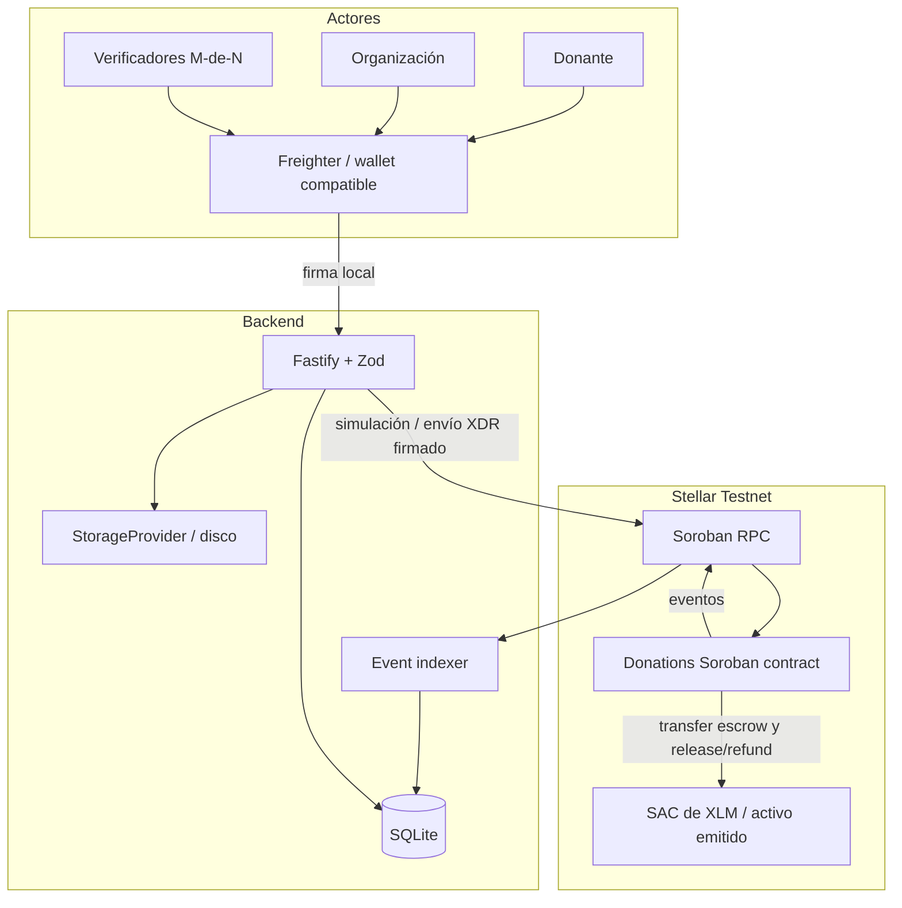

# Arquitectura de ClearFun

ClearFun combina custodia programable por contrato con una capa de consulta
fuera de cadena. El diseño actual es un prototipo para Stellar Testnet.

## Componentes

## Flujo de fondos

1. La organización autoriza `create_campaign` y define un token, el objetivo
   (suma de montos de hitos), fecha límite, lista única de verificadores y
   umbral.
2. La billetera del donante autoriza `donate`. El contrato registra su
   contribución y transfiere tokens desde su cuenta a la dirección del
   contrato SAC/token.
3. La organización autoriza el hash SHA-256 y URI de evidencia de un hito
   pendiente. Solo se puede presentar el siguiente hito hasta que los
   anteriores se hayan liberado.
4. Cada verificador autoriza como máximo un voto por hito. Al alcanzar el
   umbral, el contrato registra el estado y transfiere el monto del hito a la
   organización, si hay fondos asignados suficientes.
5. Si el contrato tiene suficientes aprobaciones pero todavía no hay fondos,
   cualquier persona puede invocar `release_milestone` cuando ya estén
   disponibles.
6. Tras el vencimiento, cada donante puede solicitar una sola vez su parte
   proporcional del saldo recaudado aún no liberado. El primer reembolso
   marca la campaña Expired e impide nuevas liberaciones.
7. Los eventos del contrato son indexados de forma idempotente en SQLite. Las
   lecturas públicas usan ese índice; auditoría compara sus importes con los
   getters y el balance actual del token consultados por RPC.

Todas las cantidades on-chain son enteros en unidades base del token. Para XLM,
un XLM corresponde a 10,000,000 stroops. El contrato no convierte monedas ni
aplica tarifas del producto.

## Roles y fronteras de confianza

| Rol                | Permisos                                                                                                 |
| ------------------ | -------------------------------------------------------------------------------------------------------- |
| Admin del contrato | Inicializa el contrato una sola vez.                                                                     |
| Organización       | Crea campañas, presenta evidencia y recibe liberaciones. No puede ser verificadora de su propia campaña. |
| Donante            | Autoriza su transferencia al escrow y, al vencimiento, su reembolso.                                     |
| Verificador        | Autoriza una aprobación por hito cuando está asignado.                                                   |
| Relayer/backend    | Simula/ensambla transacciones y remite envelopes firmados; no tiene claves de usuarios.                  |
| Indexer            | Consume eventos RPC y crea proyecciones consultables; no decide autorizaciones on-chain.                 |

## Decisiones de seguridad

- El contrato exige `require_auth()` para admin, organización, donante y
  verificador en las operaciones correspondientes.
- Valida umbral, fecha, hitos, montos, duplicados y dirección de la
  organización; las sumas y operaciones monetarias usan aritmética checked.
- Actualiza storage antes de llamar al token. La atomicidad de Soroban debe
  revertir esos cambios si falla la transferencia externa.
- Los hitos son secuenciales, los votos duplicados fallan y un hito liberado
  no se puede liberar de nuevo.
- SQLite guarda cantidades como texto decimal para evitar pérdida de precisión
  sobre `i128`; la inserción del evento y su proyección son transaccionales.
- El backend valida XDR antes de enviarlo: firma(s), una sola operación
  Soroban, contrato configurado y método de ClearFun permitido.
- CORS, límite de carga, validación de MIME y bytes mágicos, SHA-256,
  rate-limiting, Helmet y mensajes de error explícitos limitan la superficie de
  la API.
- Secretos de cuentas se configuran fuera del repositorio. Las wallets de
  usuario firman localmente.

El checklist y el pendiente bloqueante de sobre-recaudación están en
[`SECURITY_CHECKLIST.md`](./SECURITY_CHECKLIST.md).

## Limitaciones conocidas

- **Sobre-recaudación:** `donate` permite superar `goal`, mientras que la
  campaña pasa a Completed al liberar exactamente el objetivo. El excedente
  podría quedar bloqueado porque ya no se permite reembolso en Completed. No
  usar con fondos de valor hasta limitar aportes a la meta restante o definir
  y probar una política de excedentes.
- El reembolso proporcional redondea hacia abajo; residuos pequeños pueden
  quedar en escrow. El comportamiento y política de residuos deben revisarse.
- Después del primer reembolso la campaña se marca Expired, por lo que los
  demás donantes deben reclamar con esa condición; la UI/API deben explicar el
  estado.
- El indexer depende de la retención de eventos del RPC. Un apagado superior a
  la ventana de retención requiere RPC con archivo o recuperación operativa.
- SQLite es adecuado para demo y baja concurrencia, no para escalado horizontal
  multi-instancia.
- Evidencias se guardan en disco en la implementación inicial; una instancia
  pública necesita almacenamiento duradero/replicado y controles de acceso.
- La evidencia URI/hash no prueba por sí misma la veracidad material del
  documento. El proceso humano de verificación y conflictos de interés quedan
  fuera de cadena.
- CORS/rate-limit son configuración básica; el relay público necesita límites
  de costo y monitoreo apropiados. Actualmente no hay endpoint de escritura
  privilegiado que utilice `ADMIN_API_KEY`.
- Testnet, Friendbot, endpoints públicos, tarifas y finalidad no equivalen a
  garantías de producción. El contrato no tiene auditoría externa.

## Lecturas de la plataforma

Los endpoints de lectura consultan SQLite; `/campaigns/:id/audit` agrega una
consulta RPC del estado de campaña y balance de token. Las escrituras se
preparan mediante `/tx/*` y el cliente debe firmar el XDR con su wallet antes
de usar `/tx/submit`. El contrato y los eventos on-chain son la fuente de
verdad para autorizaciones y cambios de estado.
