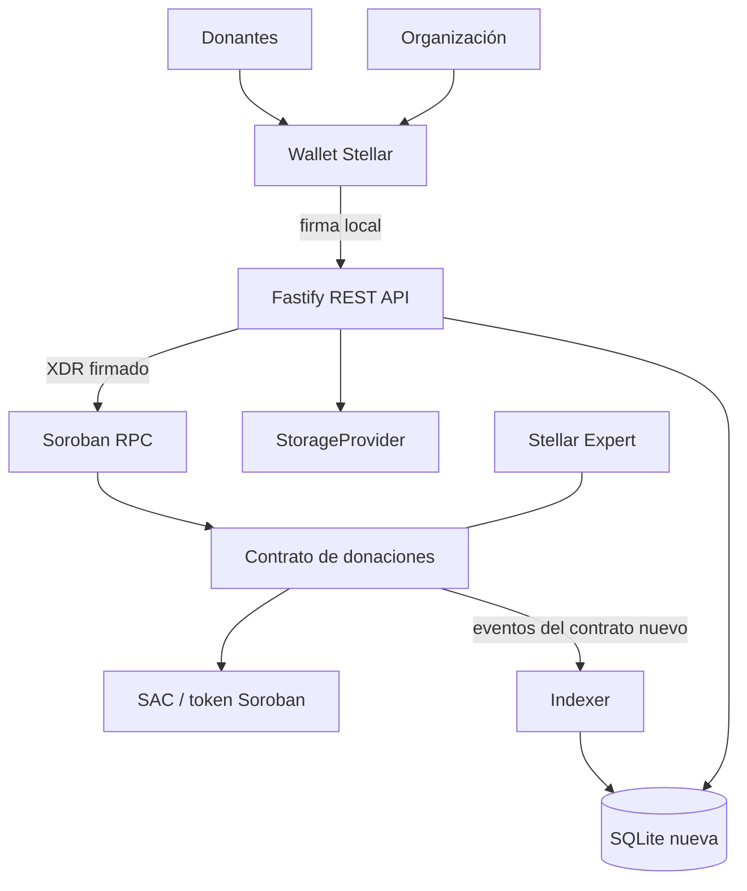

# Arquitectura de ClearFund

ClearFund usa custodia programable por contrato y una capa de consulta
indexada. Esta versión es un prototipo para Stellar Testnet; no es una entidad
financiera ni está auditada para custodiar valor real.

## Componentes

El indexer filtra por `CONTRACT_ID` activo. La base SQLite configurada para
esta versión es nueva; no se reutilizan las campañas 1–4 ni los datos del
contrato legacy. El contrato legacy y sus datos permanecen disponibles bajo
`LEGACY_CONTRACT_ID`.

## Fondos y participaciones

Cada campaña tiene un saldo retenido `held` (H), participaciones `total_shares`
(S) y época `epoch`. Una contribución inicial de `x` crea `x` participaciones;
las posteriores crean `x*S/H`, con multiplicación checked y división entera.
El valor actual de una posición es `shares*H/S`. Donar no supone adquirir un
derecho a más que el saldo real: los redondeos truncan y una donación que no
genere participaciones falla.

Una salida quema todas las participaciones del donante y transfiere su valor.
Una liberación reduce H, sin quemar participaciones. Cuando H llega a cero,
S se reinicia a cero y avanza `epoch`; las posiciones de épocas anteriores
valen cero. Las contribuciones nuevas pertenecen a la nueva época.

La organización deposita una garantía al crear la campaña:
`ceil(goal*bond_bps/10_000)`. El porcentaje se configura una sola vez y no hay
administrador posterior. En una campaña completada, la garantía vuelve a la
organización. Si vence sin completar, el primer retiro posterior al deadline
marca la garantía como Slashed y la añade al fondo repartible entre las
participaciones vigentes. Si no quedan participaciones, la organización puede
recuperar la garantía.

## Flujo

1. Una organización crea una campaña con uno o más hitos, fechas y una ventana
   pública de 60 a 2.592.000 segundos. Deposita la garantía en el mismo token.
2. Donantes distintos de la organización aportan mientras la campaña está
   activa y antes del deadline. El contrato impide superar `goal` considerando
   fondos retenidos y ya liberados.
3. La organización publica hash y URI de evidencia para el siguiente hito
   completamente financiado. Comienza la ventana pública.
4. Durante una ventana abierta, cada donante puede retirar toda su propia
   posición. Nadie vota ni aprueba. Cuando termina la ventana, cualquier cuenta
   puede invocar la liberación pública del hito.
5. Si la campaña vence y no hay una liberación ya pendiente, los donantes
   pueden retirar su valor proporcional, incluida la garantía confiscada si
   aplica. Una ventana cuya liberación ya venció bloquea los retiros con
   `ReleasePending`.
6. El indexer procesa idempotentemente los nueve eventos del contrato nuevo y
   sincroniza getters de campaña. La API compara la contabilidad de cada
   campaña con sus getters y ofrece una auditoría de solvencia por token.

Todas las cantidades son enteros en unidades base del token. XLM usa 10.000.000
stroops por XLM. Soroban revierte la transacción completa si una transferencia
del token falla; el contrato escribe su estado antes de efectuarla.

## Autorización y fronteras

- La inicialización autentica explícitamente la dirección `initializer` y
  ocurre una sola vez. El contrato no conserva un admin privilegiado.
- La organización autoriza crear, cancelar, presentar evidencia y recuperar
  una garantía bajo las condiciones del contrato.
- El donante autoriza donar y retirar su propia posición.
- `release_milestone` es pública por diseño; nadie puede bloquearla con votos.
- Los getters son lecturas públicas. La API arma XDR sin firmar y solo remite
  envelopes firmados por wallets.
- Evidencia, autenticidad material y calidad de ejecución no pueden probarse
  con un hash. La decisión de aceptar el riesgo se deja individualmente al
  donante.

## Limitaciones honestas

- El silencio durante la ventana equivale a aceptar la evidencia: al terminar,
  cualquiera puede liberar el hito.
- Una evidencia falsa pero convincente puede engañar a los donantes.
- La garantía no equivale al monto de una estafa grande; cubre como máximo el
  porcentaje configurado (máximo 50%).
- El redondeo es hacia abajo y puede dejar polvo; el contrato no ofrece una
  recuperación administrativa ni disputas.
- El indexer depende de la retención de eventos del RPC; la SQLite es para
  demo y baja concurrencia. Evidencias en disco necesitan almacenamiento
  duradero para un servicio público.
- Testnet, assets de prueba y endpoints RPC públicos no ofrecen garantías de
  producción. Se necesita revisión externa antes de usar fondos de valor.
